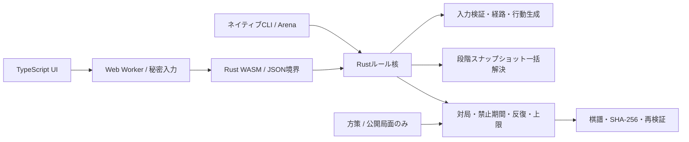

# 同時着手将棋

RULES v0.5 の段階参照解決器を **Rust** に実装し、同じ核をネイティブCLIと **WebAssembly＋TypeScript UI** から使用するローカル対局アプリです。

## 起動

Rust（1.90で検証）、Node.js 20以上、npmが必要です。WindowsのRustネイティブビルドにはMSVCのC++ビルドツールが必要です。

```powershell
rustup target add wasm32-unknown-unknown
npm ci
npm run build
npm run dev
```

[http://127.0.0.1:5173](http://127.0.0.1:5173) を開きます。サーバーはローカルホストにのみ接続し、静的ファイルを配信します。ビルド後のゲーム動作に外部サービスやフォント配信は不要です。変更後は `npm run build` とページの再読み込みで反映します。

「AIと対局」と、画面を交代する「ふたりで対局」を選べます。駒→目的地→成り・昇格の事前選択→「着手を確定」の順で操作します。味方占有先や障害の先も指定でき、成立条件は着手欄に表示されます。「選択を解除」で別の駒を選び直せます。

双方の確定後、「段階リプレイ」で任意の過去ラウンドを選び、開始・各段階・変更適用後の確定局面を確認できます。予定経路と実際の到達位置を分けて表示します。棋譜はJSONで保存し、読み込み時に最初から再計算して照合してから対局を置き換えます。

## 構成



| 場所 | 責務 |
| --- | --- |
| `crates/shogi-core/src/types.rs` | ルール版、局面、持ち駒、行動、禁止状態、初期配置 |
| `crates/shogi-core/src/action.rs` | 移動形からの経路生成、入力検証、条件付き指定の全列挙 |
| `crates/shogi-core/src/resolution.rs` | 決定論的な1ラウンド解決、捕獲根拠、段階・提案位置・実位置 |
| `crates/shogi-core/src/game.rs` | 秘密入力、同時公開、ラウンド遷移、4回反復・200ラウンド上限 |
| `crates/shogi-core/src/replay.rs` | 版付き棋譜、前後ハッシュ、ハッシュチェーン、任意ラウンドの再計算 |
| `crates/shogi-core/src/policy.rs` | 種付きの無作為・王狙い・防御・妨害・成り/昇格方策 |
| `crates/shogi-core/src/api.rs`, `wasm.rs` | CLI/WASM共通JSON API、WASMメモリの受け渡し |
| `crates/shogi-cli` | JSONL操作、棋譜検証、陣営交換付きの大量対局 |
| `web/src` | Workerとの型付き通信、行動指定、交代画面、結果説明・段階再生 |
| `review` | 既存の独立したJavaScript検証モデルと手計算46局面 |

`resolve_round(&Position, &[Action])` は入力を変更しない純粋な解決処理です。片側の手を順番に適用せず、各段階で両者の次位置を同じ状態から提案し、接触・独立捕獲・打ち成立を処理します。実時間、描画フレーム、乱数、AIの予測は裁定に入りません。

正式プロファイルは `official-v0.5`。永続昇格+1、自陣補正なし、独立パスなしを固定し、未対応の版や実験プロファイルは拒否します。反復回数・ラウンド上限は棋譜の全設定に記録します。

## 秘密入力と棋譜

`Match` の未公開入力はシリアライズ対象を持たず、公開ビューは確定済みかどうかだけを返します。片側確定時の局面・公開ハッシュは変わらず、棋譜にも未公開手を含めません。方策関数が受け取るのは公開局面だけです。ローカルの交代画面は同じ端末を交代で使うための機能です。ネット対局・認証・不正防止サーバーは含みません。

反復キーは盤面、所有者、持ち駒、成り・昇格、次ラウンドの禁止を含み、駒IDや絶対ラウンド数を含みません。棋譜検証用のハッシュはID割当・対局履歴・設定も含めます。打ち駒IDは対局を通して単調なカウンタから発行し、再利用しません。

棋譜形式は `simultaneous-shogi/replay-v1`。初期状態・ルール版と全設定・両者の行動列・前後状態/解決結果/チェーンのSHA-256を保持します。同じ版で全ラウンドを再実行し、局面と終局を照合します。旧版を黙って読み替えません。詳細診断を省いて対局しても同じ棋譜になり、再検証時に段階記録を復元できます。

## ネイティブ実行と大量対局

```powershell
cargo run -p shogi-cli --release -- initial
cargo run -p shogi-cli --release -- arena 500 42 hunter random off
cargo run -p shogi-cli --release -- arena 500 42 hunter random on
Get-Content -Raw .\game.json | cargo run -p shogi-cli --release -- verify
```

Arenaの引数は `ペア数 乱数種 方策1 方策2 診断on/off`。1ペアで陣営を交換した2局を実行し、乱数列は方策に追従します。`wins` 配列は方策1・方策2の勝数です。`random` / `hunter` / `defense` / `interference` / `upgrade` を指定できます。探索・強化学習はまだ行いません。

JSON出力には勝敗、平均ラウンド、駒種別の生存・捕獲、格7の盤上駒ラウンド数、成り・昇格、到達・部分移動・移動0・被捕獲、連戦/通常捕獲/打ち駒捕獲、打ち成立・不成立などの集計を含みます。方策時間と対局解決時間を別に計測します。後者には対局履歴・棋譜ハッシュ生成も含むため、純粋な解決器だけの性能値とは区別します。

今回の1,000局比較は診断on/offで全結果が一致しました。条件と実測値は [BENCHMARK.md](BENCHMARK.md) に記録しています。

`shogi resolve` は既存検証局面と同じ `{pieces,hands,actions,...}` のJSONを1行ずつ読み、`{ok,value}` または `{ok:false,error}` を返します。`shogi api` は同じプロセスでセッションを保持するJSONL APIです。

```json
{"cmd":"new"}
{"cmd":"submit","side":"A","action":{"side":"A","type":"move","piece":"A:P:7","to":[7,6],"choice":"none"}}
{"cmd":"submit_ai","side":"B","policy":"hunter","seed":1}
{"cmd":"replay_round","round":1}
{"cmd":"export"}
```

座標は `[筋,段]` の各1〜9。Aは段が小さくなる方向、Bは大きくなる方向へ進みます。APIは `actions`（陣営別の指定可能手と成立条件）、`view`、`import`、`resolve`、`hash` も提供します。

## 検証

```powershell
npm test
npm run check
```

`npm test` はRust回帰試験、既存JS試験、ネイティブ/WASM/UIのビルド、実装間比較、Workerを使うDOM結合試験を順に実行します。

- 手計算46局面（44解決・2入力拒否）と独立した段階式による飛車4,608組合せ。
- 生成1,000局面でJS・ネイティブRust・WASMの最終状態、捕獲、接触段階、段階盤面を比較。
- 駒保存、入力/列挙順、ID変更、盤回転＋陣営交換の不変性。
- 対局の秘密保持、入力エラー時の状態保持、禁止消化、反復/上限/王捕獲優先、棋譜の版・ハッシュ検証。
- 32bit WASMと64bitネイティブの種付き方策一致、診断on/offの同一結果・同一棋譜。
- 実WorkerとWASMを使い、AI対局、条件表示、交代入力、同時公開、過去ラウンド再生、無効棋譜の読み込みをDOM上で操作。

`npm run check` はRust整形・Clippy（警告をエラー扱い）とTypeScriptのstrict型検査です。DOM試験は見た目やレイアウトを検証しません。この環境ではBrowser接続が利用できず、実画面の視覚確認は未実施です。

裁定の正本は [RULES.md](RULES.md)、設計は [SYSTEM_DESIGN.md](SYSTEM_DESIGN.md)。高速版Bやバランス実験への切り替えは行っていません。
