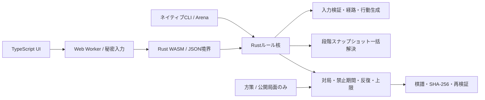

# 同時着手将棋

RULES v0.7 の段階参照解決器を **Rust** に実装し、同じ核をネイティブCLI、**WebAssembly＋TypeScript UI**、オンライン対戦サーバーから使用する将棋ゲームです。AI対戦、インターネット対戦、両陣営を操作する1端末モード、段階ごとの検討に対応します。

## 起動

WindowsではルートフォルダーのBATをダブルクリックします。

| BAT | 起動内容 |
| --- | --- |
| `start-game.bat` | ゲーム・オンライン対戦サーバーを起動し、準備完了後に既定のブラウザーでゲーム画面を開く |
| `start-server.bat` | ゲーム・オンライン対戦サーバーを起動し、PC内URL・LAN内URL・直接接続用のIPv6 URLを表示する |
| `dashboard/start.bat` | AI学習・評価のコントロールパネルを開く |
| `start-training.bat` | 標準の学習コードをCLIで起動する |

ゲーム用BATは必要なnpm依存とWASMターゲットを初回に導入し、毎回ビルドしてソースの変更を反映します。Node.js 20以上・npm・Rust（rustup）を先にインストールしてください。初回の依存取得にはインターネット接続が必要です。起動したコンソールはサーバー稼働中は開いたままにし、終了は `Ctrl+C`。ブラウザーのタブを閉じてもサーバーは継続します。起動エラーはコンソールに表示して停止します。`HOST` / `PORT` / `DATA_DIR` / `PUBLIC_URL` の環境変数も使用できます。

対戦通信は、このPCと相手の端末で直接行います。起動時にこのPCのグローバルIPv6アドレスがあれば **「インターネット (直接接続): http://[...]...」** と表示します。Windows側のゲーム用ポート（既定TCP 5173番）はBATが自動で受信許可を設定します。初回にWindowsの管理者確認（UAC）が出たら「はい」を選んでください。設定済みなら次回以降の確認は不要です。相手もIPv6に対応し、ルーター側で受信を許可していれば、このURLで接続できます。IPv4ではルーターのポート転送も必要です。IPv4の外部IPはルーターで確認し、`PUBLIC_URL=http://外部IP:公開ポート/` を設定すると共有用URLを表示できます。詳しくは [DEPLOYMENT.md](DEPLOYMENT.md) を参照してください。

AIの学習・評価は `dashboard/start.bat` または `npm run dashboard` で専用ウィンドウを開きます。ローカルGPU学習、Colab連携、世代別成績、棋譜・局面分析に対応しています。GPU環境の初回セットアップは `dashboard/setup-gpu.bat`。ブラウザで使う場合は `npm run dashboard:server` → [http://localhost:5180](http://localhost:5180)。手順は [training/README.md](training/README.md)、技術調査は [TRAINING_RESEARCH.md](TRAINING_RESEARCH.md) を参照してください。

通常の学習は高速化版を使用します。局面特徴量と混合戦略のRust処理、81bit経路マスク、GPUの損失一括計算を統合済みです。実測と条件は [学習の高速化比較](benchmarks/training-performance/PERFORMANCE.md) に記録しています。

ダッシュボードの設定で既存AIを有効にすると、自己対戦の既定25%にやねうら王などのUSIエンジンを混ぜ、定期評価でも対戦します。探索量の既定は**2,000ノード**で変更可能。勝率・得点率・勝敗数・既存AIの着手採用率を世代別に保存します。「強さ・比較」から既存AIとの追加評価と、保存した教師データによる別モデルへの蒸留も実行できます。未準備の場合は設定の「既存AIを準備」を使用します。詳しくは [公開将棋AIの利用手順](EXTERNAL_SHOGI.md) を参照してください。

Rust（1.90で検証）、Node.js 20以上、npmが必要です。WindowsのRustネイティブビルドにはMSVCのC++ビルドツールが必要です。

```powershell
rustup target add wasm32-unknown-unknown
npm ci
npm run build
npm run dev
```

[http://localhost:5173](http://localhost:5173) を開きます。サーバーは既定で `[::]:5173` でIPv4・IPv6を受け付け、ゲーム画面とHTTP/SSE対戦APIを配信します。IPv6を利用できない環境ではIPv4に切り替えます。同じネットワークの別端末は、起動時に表示するLAN用URLから接続できます。ビルド後のゲーム動作に外部サービスやフォント配信は不要です。変更後は `npm run build` とページの再読み込みで反映します。インターネット公開とDocker構成は [DEPLOYMENT.md](DEPLOYMENT.md) を参照してください。

最初はゲームのメインメニューを表示します。「AI対戦」は対戦相手（学習済みAI／既存AI）と自分の陣営を選んで開始。学習済みAIでは実行・世代も選べます。「インターネット対戦」は名前を入力して部屋を作るか、名前と6桁の部屋番号で参加し、双方が準備完了すると開始します。「1端末モード」は両陣営の名前を設定して開始。盤の向きを固定し、交代画面を挟まずに両側の手を入力できます。操作する陣営は盤の上で選べ、片側が確定すると未入力側へ自動で切り替わります。双方が揃うと、インターネット対戦と共通のルールで同時解決し、同じ演出・棋譜・結果画面を表示します。終局後の振り返り・再戦にも対応します。

ホームの「テストモード」では駒を自由に配置できます。盤上の駒は左ドラッグ＆ドロップで移動し、盤外で離すと削除。右クリックすると駒のそばに編集UIが開き、陣営・通常・成り・昇格を切り替えられます。Escapeでドラッグを取り消し、編集UIを閉じられます。駒→移動先のクリック操作も使え、一覧から駒を選ぶと連続で追加できます。「削除」で取り除き、左側の陣営・状態の選択欄でも選択中の駒を編集できます。「持ち駒を編集」で選択中の陣営の枚数を増減します。相手の持ち駒の下にある「初期盤面」はワンボタンで平手へ戻し、「盤面を空にする」は両陣営の持ち駒も含めて空にします。両陣営の王を1枚ずつ置いて「この配置でテスト」を押すと、両側の手を入力して実際のルールで動作確認できます。途中でも段階リプレイを確認でき、「現在の局面を編集」で配置へ戻り、「同じ配置で再テスト」で開始配置からやり直せます。配置を編集すると、着手禁止・連続移動による格低下・棋譜はリセットします。

駒→移動先で即座に着手を確定します。持ち駒も同様です。成り・昇格が適用され得る場合だけ、盤のそばに「成る」「昇格 +1」の2択を表示し、選択後に確定。昇格後は選択を表示せず、強制成りの場合だけ成り駒へ変わります。文字は同梱の筆文字フォントで、通常は黒、成りは赤、昇格は青に分けます。PCの駒台は相手側が盤の左上、自分側が右下。スマホでは盤の下に配置し、持ち駒も五角形で表示します。味方占有先や障害の先も条件付きで指定でき、候補の表示とツールチップで条件を確認できます。取消・Escapeで選び直せます。

双方の確定後は同時移動し、衝突が起きると両者の駒・格・勝者または相討ちを表示します。終局時には勝利・敗北・引き分けを演出し、最終盤面、振り返り、再戦、ホームへ進めます。オンラインは同じ部屋へ戻り、再度双方が準備完了して連戦できます。

対戦中の棋譜は閲覧のみで、右上のボタンから非表示にできます。終局後や棋譜の検討では「段階リプレイ」や棋譜のラウンドを選び、開始・各段階・変更適用後の確定局面を確認できます。予定位置と実際の到達位置を分けて表示します。棋譜はJSONで保存し、読み込み時に最初から再計算して照合してから置き換えます。未終局の棋譜は、その局面からAI対戦を続けられます。指定のWAV音源を着地音と衝突音に使用し、右上のスピーカーで切り替えます。効果音、格の表示、演出の軽減は設定からも変更できます。

## AIモデルの保存場所とゲームでの選択

新しいAI対戦・ローカル対戦・オンライン対戦は `D+ALL2-C1` を使用します。全種類の駒が連続2回目の移動から一時的に格−1（下限0）となり、1ラウンド休むと回復します。3回目以降も低下は−1までで、昇格は維持します。自陣3段では移動中同士の衝突だけ防御+1、停止中の駒は従来どおり格に関係なく捕獲されます。青いオーラは自陣で防御補正が働くときだけ表示し、陣外の昇格駒には出しません。格低下中は紫を優先し、陣地の塗り分けや文字表示は追加しません。旧 `D+B2-C1` の学習ログと棋譜は元のルールのまま残します。

実対戦の設定は `web/src/rules.ts` で共有します。新規対局はv0.7の王捕獲後の勝利維持を適用し、保存済みv0.6の対局は記録された旧ルールで復元します。既存モデルの保存ファイルは変更しませんが、ルール版が変わるため、v0.7の学習済みAIとの対戦には対応する学習モデルが必要です。

学習済みニューラルネットは、ローカルでは `dashboard/runs/<実行名>/checkpoints/g0000.pt`、`g0001.pt` … に世代別で保存します。Colabの永続保存先は `MyDrive/Simultaneous_Shogi/runs/<RUN_NAME>/checkpoints/`。チェックポイントには重みと再開用のoptimizer・乱数状態などを保存します。

| 各実行の `manifest.json` の項目 | 用途 |
| --- | --- |
| `latest_checkpoint` | 最後に保存が確定した世代。学習再開と追加評価の既定モデル |
| `champion_checkpoint` | 対戦評価の基準モデル。初期世代から始まり、昇格条件を満たした世代へ更新。最新世代と同じとは限らない |

ゲームから学習済みモデルを使う手順：

1. `start-game.bat` を開き、「AI対戦」を選ぶ。
2. 「対戦するAI」で「学習済みAI」を選び、「学習実行」と「使用する世代」を選ぶ。最新世代とchampionには印を表示し、初期選択は最新世代。
3. 自分の陣営を選び、「モデルを読み込んで対局」を押す。対局中は選んだ世代を固定し、画面にもモデル名・世代を表示する。

一覧はローカルの `dashboard/runs` と、学習パネルで設定したDriveの同期フォルダーを参照します。新たに学習・取り込みしたモデルは「一覧を更新」で反映します。Colabの結果ZIPは先に学習パネルで取り込んでください。形式やルール・ラウンド制限が異なる実行は選べません。

学習済みモデルとの対局は、ゲームサーバーを起動したPCの [http://localhost:5173](http://localhost:5173) または `127.0.0.1` で利用できます。Python・PyTorch・NumPyは学習パネルと同じ環境（`.venv` 優先、`SHOGI_PYTHON` で変更可能）を使います。初回は `dashboard/setup-gpu.bat` で準備します。GPUが使えない場合もCPUで思考できます。必要なネイティブエンジンは初回読み込み時にビルドします。

既存AIとの対戦は、「対戦するAI」→「既存AI（やねうら王 / USI）」→自分の陣営→「既存AIに接続して対局」。保存済みモデルは不要で、Python・NumPyと準備済みのUSIエンジンを使います。未準備の場合は学習パネルの設定で「既存AIを準備」を実行し、ゲームの「接続を確認」を押してください。既定はやねうら王＋Háo・2,000ノードで、学習パネルに保存したエンジンと探索量の設定を使用し、対局中は固定します。学習用の既存AIとの対戦を無効にしていても、ゲームでは選択できます。こちらもサーバーを起動したPCのlocalhostで利用します。詳しくは [公開将棋AIの利用手順](EXTERNAL_SHOGI.md) を参照してください。

基本AI単独の選択肢はありません。通常将棋に変換できない局面や対応する指定がない場合に限り、既存AIの接続処理が本ルール対応のhunterを補助に使います。AIの終了や通信失敗では手を進めず、再試行できます。インターネット対戦・1端末モードはPythonを使用しません。

学習モデルには解決済みの公開棋譜だけを渡し、人間の今回の指定は渡しません。推論に失敗した場合は着手前の状態を保ち、再試行できます。読み込みではモデル形式・重み・ルールハッシュを検証します。学習専用コードの変更によるソース識別子の違いは、対局用途では読み込みを妨げません（学習再開・追加評価の厳密な一致条件は従来どおり）。

学習済みモデルは学習コントロールパネルでの自己対戦・評価・局面分析に使用します。CLIの追加評価では `--run-dir` で実行を選び、`--checkpoint 5` のように世代を指定できます（省略時は `latest_checkpoint`）。詳しくは [training/README.md](training/README.md) を参照してください。

## 構成



| 場所 | 責務 |
| --- | --- |
| `crates/shogi-core/src/types.rs` | ルール版、局面、持ち駒、行動、禁止状態、初期配置 |
| `crates/shogi-core/src/action.rs` | 移動形からの経路生成、入力検証、条件付き指定の全列挙 |
| `crates/shogi-core/src/resolution.rs` | 決定論的な1ラウンド解決、捕獲根拠、段階・提案位置・実位置 |
| `crates/shogi-core/src/game.rs` | 秘密入力、同時公開、ラウンド遷移、4回反復・200ラウンド上限 |
| `crates/shogi-core/src/replay.rs` | 版付き棋譜、前後ハッシュ、ハッシュチェーン、任意ラウンドの再計算 |
| `crates/shogi-core/src/policy.rs` | 種付きの無作為・王狙い・防御・妨害・成り/昇格方策 |
| `crates/shogi-core/src/api.rs`, `wasm.rs` | CLI/WASM共通JSON API、WASMメモリの受け渡し |
| `crates/shogi-cli` | JSONL操作、棋譜検証、陣営交換付きの大量対局 |
| `web/src` | Workerとの型付き通信、行動指定、1端末モードの陣営切替、結果説明・段階再生 |
| `web/src/online.ts`, `server` | 認証付きHTTP/SSE、部屋・準備・同時着手、再接続、永続化、サーバー裁定 |
| `web/src/models.ts`, `server/models.mjs`, `server/model_worker.py` | 保存済みモデルの一覧・世代選択、常駐Pythonによる推論、公開棋譜の検証と同時探索 |
| `server/external.mjs`, `server/external_worker.py` | ゲームでの既存AI選択・接続、USI着手の変換、公開棋譜の検証 |
| `review` | 既存の独立したJavaScript検証モデルと手計算46局面 |

`resolve_round(&Position, &[Action])` は入力を変更しない純粋な解決処理です。片側の手を順番に適用せず、各段階で両者の次位置を同じ状態から提案し、接触・独立捕獲・打ち成立を処理します。実時間、描画フレーム、乱数、AIの予測は裁定に入りません。

正式プロファイルは `official-v0.7`（比較実験のA）。王を取った駒が同ラウンドで取り返されても、王を取った側が勝ちます。永続昇格+1、昇格後は強制成りのみ、自陣補正なし、独立パスなしを維持します。実験専用の `balance-v1` はB/B+/C/C+/D/D+の全設定を棋譜に保存し、探索と実対局で同じ裁定を使用します。v0.6の棋譜は旧裁定のまま検証・再生し、v0.5など未対応の棋譜は拒否します。ルール版が異なる学習モデルは新規対局に混在させません。連戦の格合算案は [検討資料](./RULE_REVIEW_V07.md) にまとめています。

## 秘密入力と棋譜

`Match` の未公開入力はシリアライズ対象を持たず、公開ビューは確定済みかどうかだけを返します。片側確定時の局面・公開ハッシュは変わらず、棋譜にも未公開手を含めません。方策関数が受け取るのは公開局面だけです。1端末モードでも、双方の入力が揃うまで盤面を進めず、確定済みの手は変更できません。

オンラインでは部屋ごとにサーバー側で同じRust/WASMのMatchを実行します。席用のランダムなBearerトークンで陣営を固定し、未公開手は相手のレスポンス・SSE・棋譜へ一切送りません。操作は部屋内で直列化し、対局IDとラウンドで古い着手や二重送信を拒否します。復旧ファイルだけに未公開手を保存し、再起動時にも双方の入力状態を復元します。保存先は `data/rooms`（`DATA_DIR`で変更可能）で、HTTP配信の対象外・Git管理の対象外です。

切断中は着手を停止し、検出後90秒の復帰猶予を表示します。無応答の接続は30秒のheartbeat切れで検出。片側が戻らなければその側の負け、双方なら引き分けです。同じタブでの再読込は自動復帰し、待機室の切断では準備完了を解除します。明示的な対局中の退出は負けとなり、空席へ別の相手が参加できます。部屋は無接続で24時間更新がなければ削除します。

反復キーは盤面、所有者、持ち駒、成り・昇格、次ラウンドの禁止を含み、駒IDや絶対ラウンド数を含みません。棋譜検証用のハッシュはID割当・対局履歴・設定も含めます。打ち駒IDは対局を通して単調なカウンタから発行し、再利用しません。

棋譜形式は `simultaneous-shogi/replay-v1`。初期状態・ルール版と全設定・両者の行動列・前後状態/解決結果/チェーンのSHA-256を保持します。同じ版で全ラウンドを再実行し、局面と終局を照合します。旧版を黙って読み替えません。詳細診断を省いて対局しても同じ棋譜になり、再検証時に段階記録を復元できます。

## ネイティブ実行と大量対局

```powershell
cargo run -p shogi-cli --release -- initial
cargo run -p shogi-cli --release -- arena 500 42 hunter random off
cargo run -p shogi-cli --release -- arena 500 42 hunter random on
Get-Content -Raw .\game.json | cargo run -p shogi-cli --release -- verify
```

Arenaの引数は `ペア数 乱数種 方策1 方策2 診断on/off`。1ペアで陣営を交換した2局を実行し、乱数列は方策に追従します。`wins` 配列は方策1・方策2の勝数です。`random` / `hunter` / `defense` / `interference` / `upgrade` を指定できます。探索・強化学習はまだ行いません。

JSON出力には勝敗、平均ラウンド、駒種別の生存・捕獲、格7の盤上駒ラウンド数、成り・昇格、到達・部分移動・移動0・被捕獲、連戦/通常捕獲/打ち駒捕獲、打ち成立・不成立などの集計を含みます。方策時間と対局解決時間を別に計測します。後者には対局履歴・棋譜ハッシュ生成も含むため、純粋な解決器だけの性能値とは区別します。

今回の1,000局比較は診断on/offで全結果が一致しました。条件と実測値は [BENCHMARK.md](BENCHMARK.md) に記録しています。

`shogi resolve` は既存検証局面と同じ `{pieces,hands,actions,...}` のJSONを1行ずつ読み、`{ok,value}` または `{ok:false,error}` を返します。`shogi api` は同じプロセスでセッションを保持するJSONL APIです。

```json
{"cmd":"new"}
{"cmd":"submit","side":"A","action":{"side":"A","type":"move","piece":"A:P:7","to":[7,6],"choice":"none"}}
{"cmd":"submit_ai","side":"B","policy":"hunter","seed":1}
{"cmd":"replay_round","round":1}
{"cmd":"export"}
```

座標は `[筋,段]` の各1〜9。Aは段が小さくなる方向、Bは大きくなる方向へ進みます。APIは `actions`（陣営別の指定可能手と成立条件）、`view`、`import`、`resolve`、`hash` も提供します。

## 検証

```powershell
npm test
npm run check
npm run test:browser
```

学習モデルの接続は、学習用Python環境を準備してから `npm run test:models` で確認できます。実際のPyTorch重みとネイティブエンジンを使い、世代選択・両陣営の着手・棋譜検証・長い対局・モデル破損と復旧・公開入力だけの使用を検証します。

`npm test` はRust回帰試験、既存JS試験、ネイティブ/WASM/UIのビルド、実装間比較、Workerを使うDOM結合試験、実HTTP/SSEのオンライン結合試験を順に実行します。

- 手計算46局面（44解決・2入力拒否）と独立した段階式による飛車4,608組合せ。
- 生成1,000局面でJS・ネイティブRust・WASMの最終状態、捕獲、接触段階、段階盤面を比較。
- 駒保存、入力/列挙順、ID変更、盤回転＋陣営交換の不変性。
- 対局の秘密保持、入力エラー時の状態保持、禁止消化、反復/上限/王捕獲優先、棋譜の版・ハッシュ検証。
- 32bit WASMと64bitネイティブの種付き方策一致、診断on/offの同一結果・同一棋譜。
- 実WorkerとWASMを使い、ホーム・設定、即時着手、持ち駒、成り・昇格、条件表示、交代入力、同時公開、過去ラウンド再生、無効棋譜の拒否、勝敗・引き分け、検討・再戦をDOM上で操作。
- 独立した2クライアントで、部屋作成・参加・準備、認証、秘密入力の不在、衝突、再送・不正入力、同室再戦、切断猶予、再起動時の未公開手復元、退出を検証。

`npm run check` はRust整形・Clippy（警告をエラー扱い）とTypeScriptのstrict型検査です。`npm run test:browser` は隔離したPC・スマートフォン用Chrome/Chromiumで、実画面の配置・文字色・操作・演出、オンライン接続・再読込・ネットワーク復帰・連戦を確認します。スクリーンショットは `artifacts/screenshots`。WindowsのChrome/Edgeを自動検出し、その他はPlaywrightのChromiumまたは `CHROME_PATH` を使用します。

参考サイトの調査、画面遷移、演出・秘密入力の設計は [UI_UX_DESIGN.md](UI_UX_DESIGN.md) にまとめています。

裁定の正本は [RULES.md](RULES.md)、設計は [SYSTEM_DESIGN.md](SYSTEM_DESIGN.md)。高速版Bやバランス実験への切り替えは行っていません。
