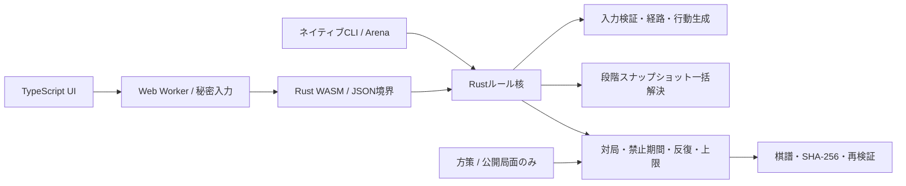

# 同時着手将棋

RULES v0.6 の段階参照解決器を **Rust** に実装し、同じ核をネイティブCLI、**WebAssembly＋TypeScript UI**、オンライン対戦サーバーから使用する将棋ゲームです。AI対戦、インターネット対戦、ひとつの端末での2人対局、段階ごとの検討に対応します。

## 起動

AIの学習・評価は `npm run dashboard` で [http://localhost:5180](http://localhost:5180) を開きます。Colab用ノートブック、結果の取り込み、世代別成績、棋譜・局面分析を備えています。手順は [training/README.md](training/README.md)、既存技術との比較と採用理由は [TRAINING_RESEARCH.md](TRAINING_RESEARCH.md) を参照してください。

Rust（1.90で検証）、Node.js 20以上、npmが必要です。WindowsのRustネイティブビルドにはMSVCのC++ビルドツールが必要です。

```powershell
rustup target add wasm32-unknown-unknown
npm ci
npm run build
npm run dev
```

[http://localhost:5173](http://localhost:5173) を開きます。サーバーは既定で `0.0.0.0:5173` に接続し、ゲーム画面とHTTP/SSE対戦APIを配信します。同じネットワークの別端末は、このPCのLANアドレスから接続できます。ビルド後のゲーム動作に外部サービスやフォント配信は不要です。変更後は `npm run build` とページの再読み込みで反映します。インターネット公開とDocker構成は [DEPLOYMENT.md](DEPLOYMENT.md) を参照してください。

最初はゲームのメインメニューを表示します。「AI対戦」は相手の方針と自分の陣営を選んで開始。「インターネット対戦」は名前を入力して部屋を作るか、名前と6桁の部屋番号で参加し、双方が準備完了すると開始します。「ひとつの端末で対戦」も維持しています。

駒→移動先で即座に着手を確定します。持ち駒も同様です。成り・昇格が適用され得る場合だけ、盤のそばに「成る」「昇格 +1」の2択を表示し、選択後に確定。昇格後は選択を表示せず、強制成りの場合だけ成り駒へ変わります。文字は同梱の筆文字フォントで、通常は黒、成りは赤、昇格は青に分けます。PCの駒台は相手側が盤の左上、自分側が右下。スマホでは盤の下に配置し、持ち駒も五角形で表示します。味方占有先や障害の先も条件付きで指定でき、候補の表示とツールチップで条件を確認できます。取消・Escapeで選び直せます。

双方の確定後は同時移動し、衝突が起きると両者の駒・格・勝者または相討ちを表示します。終局時には勝利・敗北・引き分けを演出し、最終盤面、振り返り、再戦、ホームへ進めます。オンラインは同じ部屋へ戻り、再度双方が準備完了して連戦できます。

対戦中の棋譜は閲覧のみで、右上のボタンから非表示にできます。終局後や棋譜の検討では「段階リプレイ」や棋譜のラウンドを選び、開始・各段階・変更適用後の確定局面を確認できます。予定位置と実際の到達位置を分けて表示します。棋譜はJSONで保存し、読み込み時に最初から再計算して照合してから置き換えます。未終局の棋譜は、その局面からAI対戦を続けられます。指定のWAV音源を着地音と衝突音に使用し、右上のスピーカーで切り替えます。効果音、格の表示、演出の軽減は設定からも変更できます。

## 構成



| 場所 | 責務 |
| --- | --- |
| `crates/shogi-core/src/types.rs` | ルール版、局面、持ち駒、行動、禁止状態、初期配置 |
| `crates/shogi-core/src/action.rs` | 移動形からの経路生成、入力検証、条件付き指定の全列挙 |
| `crates/shogi-core/src/resolution.rs` | 決定論的な1ラウンド解決、捕獲根拠、段階・提案位置・実位置 |
| `crates/shogi-core/src/game.rs` | 秘密入力、同時公開、ラウンド遷移、4回反復・200ラウンド上限 |
| `crates/shogi-core/src/replay.rs` | 版付き棋譜、前後ハッシュ、ハッシュチェーン、任意ラウンドの再計算 |
| `crates/shogi-core/src/policy.rs` | 種付きの無作為・王狙い・防御・妨害・成り/昇格方策 |
| `crates/shogi-core/src/api.rs`, `wasm.rs` | CLI/WASM共通JSON API、WASMメモリの受け渡し |
| `crates/shogi-cli` | JSONL操作、棋譜検証、陣営交換付きの大量対局 |
| `web/src` | Workerとの型付き通信、行動指定、交代画面、結果説明・段階再生 |
| `web/src/online.ts`, `server` | 認証付きHTTP/SSE、部屋・準備・同時着手、再接続、永続化、サーバー裁定 |
| `review` | 既存の独立したJavaScript検証モデルと手計算46局面 |

`resolve_round(&Position, &[Action])` は入力を変更しない純粋な解決処理です。片側の手を順番に適用せず、各段階で両者の次位置を同じ状態から提案し、接触・独立捕獲・打ち成立を処理します。実時間、描画フレーム、乱数、AIの予測は裁定に入りません。

正式プロファイルは `official-v0.6`。永続昇格+1、昇格後は強制成りのみ、自陣補正なし、独立パスなしを固定し、未対応の版や実験プロファイルは拒否します。反復回数・ラウンド上限は棋譜の全設定に記録します。ルールの異なるv0.5の棋譜は取り込みを拒否し、保存済みルームは非公開のアーカイブへ内容を変えず保管します。

## 秘密入力と棋譜

`Match` の未公開入力はシリアライズ対象を持たず、公開ビューは確定済みかどうかだけを返します。片側確定時の局面・公開ハッシュは変わらず、棋譜にも未公開手を含めません。方策関数が受け取るのは公開局面だけです。ローカルの交代画面は同じ端末を交代で使うための機能です。

オンラインでは部屋ごとにサーバー側で同じRust/WASMのMatchを実行します。席用のランダムなBearerトークンで陣営を固定し、未公開手は相手のレスポンス・SSE・棋譜へ一切送りません。操作は部屋内で直列化し、対局IDとラウンドで古い着手や二重送信を拒否します。復旧ファイルだけに未公開手を保存し、再起動時にも双方の入力状態を復元します。保存先は `data/rooms`（`DATA_DIR`で変更可能）で、HTTP配信の対象外・Git管理の対象外です。

切断中は着手を停止し、検出後90秒の復帰猶予を表示します。無応答の接続は30秒のheartbeat切れで検出。片側が戻らなければその側の負け、双方なら引き分けです。同じタブでの再読込は自動復帰し、待機室の切断では準備完了を解除します。明示的な対局中の退出は負けとなり、空席へ別の相手が参加できます。部屋は無接続で24時間更新がなければ削除します。

反復キーは盤面、所有者、持ち駒、成り・昇格、次ラウンドの禁止を含み、駒IDや絶対ラウンド数を含みません。棋譜検証用のハッシュはID割当・対局履歴・設定も含めます。打ち駒IDは対局を通して単調なカウンタから発行し、再利用しません。

棋譜形式は `simultaneous-shogi/replay-v1`。初期状態・ルール版と全設定・両者の行動列・前後状態/解決結果/チェーンのSHA-256を保持します。同じ版で全ラウンドを再実行し、局面と終局を照合します。旧版を黙って読み替えません。詳細診断を省いて対局しても同じ棋譜になり、再検証時に段階記録を復元できます。

## ネイティブ実行と大量対局

```powershell
cargo run -p shogi-cli --release -- initial
cargo run -p shogi-cli --release -- arena 500 42 hunter random off
cargo run -p shogi-cli --release -- arena 500 42 hunter random on
Get-Content -Raw .\game.json | cargo run -p shogi-cli --release -- verify
```

Arenaの引数は `ペア数 乱数種 方策1 方策2 診断on/off`。1ペアで陣営を交換した2局を実行し、乱数列は方策に追従します。`wins` 配列は方策1・方策2の勝数です。`random` / `hunter` / `defense` / `interference` / `upgrade` を指定できます。探索・強化学習はまだ行いません。

JSON出力には勝敗、平均ラウンド、駒種別の生存・捕獲、格7の盤上駒ラウンド数、成り・昇格、到達・部分移動・移動0・被捕獲、連戦/通常捕獲/打ち駒捕獲、打ち成立・不成立などの集計を含みます。方策時間と対局解決時間を別に計測します。後者には対局履歴・棋譜ハッシュ生成も含むため、純粋な解決器だけの性能値とは区別します。

今回の1,000局比較は診断on/offで全結果が一致しました。条件と実測値は [BENCHMARK.md](BENCHMARK.md) に記録しています。

`shogi resolve` は既存検証局面と同じ `{pieces,hands,actions,...}` のJSONを1行ずつ読み、`{ok,value}` または `{ok:false,error}` を返します。`shogi api` は同じプロセスでセッションを保持するJSONL APIです。

```json
{"cmd":"new"}
{"cmd":"submit","side":"A","action":{"side":"A","type":"move","piece":"A:P:7","to":[7,6],"choice":"none"}}
{"cmd":"submit_ai","side":"B","policy":"hunter","seed":1}
{"cmd":"replay_round","round":1}
{"cmd":"export"}
```

座標は `[筋,段]` の各1〜9。Aは段が小さくなる方向、Bは大きくなる方向へ進みます。APIは `actions`（陣営別の指定可能手と成立条件）、`view`、`import`、`resolve`、`hash` も提供します。

## 検証

```powershell
npm test
npm run check
npm run test:browser
```

`npm test` はRust回帰試験、既存JS試験、ネイティブ/WASM/UIのビルド、実装間比較、Workerを使うDOM結合試験、実HTTP/SSEのオンライン結合試験を順に実行します。

- 手計算46局面（44解決・2入力拒否）と独立した段階式による飛車4,608組合せ。
- 生成1,000局面でJS・ネイティブRust・WASMの最終状態、捕獲、接触段階、段階盤面を比較。
- 駒保存、入力/列挙順、ID変更、盤回転＋陣営交換の不変性。
- 対局の秘密保持、入力エラー時の状態保持、禁止消化、反復/上限/王捕獲優先、棋譜の版・ハッシュ検証。
- 32bit WASMと64bitネイティブの種付き方策一致、診断on/offの同一結果・同一棋譜。
- 実WorkerとWASMを使い、ホーム・設定、即時着手、持ち駒、成り・昇格、条件表示、交代入力、同時公開、過去ラウンド再生、無効棋譜の拒否、勝敗・引き分け、検討・再戦をDOM上で操作。
- 独立した2クライアントで、部屋作成・参加・準備、認証、秘密入力の不在、衝突、再送・不正入力、同室再戦、切断猶予、再起動時の未公開手復元、退出を検証。

`npm run check` はRust整形・Clippy（警告をエラー扱い）とTypeScriptのstrict型検査です。`npm run test:browser` は隔離したPC・スマートフォン用Chrome/Chromiumで、実画面の配置・文字色・操作・演出、オンライン接続・再読込・ネットワーク復帰・連戦を確認します。スクリーンショットは `artifacts/screenshots`。WindowsのChrome/Edgeを自動検出し、その他はPlaywrightのChromiumまたは `CHROME_PATH` を使用します。

参考サイトの調査、画面遷移、演出・秘密入力の設計は [UI_UX_DESIGN.md](UI_UX_DESIGN.md) にまとめています。

裁定の正本は [RULES.md](RULES.md)、設計は [SYSTEM_DESIGN.md](SYSTEM_DESIGN.md)。高速版Bやバランス実験への切り替えは行っていません。
