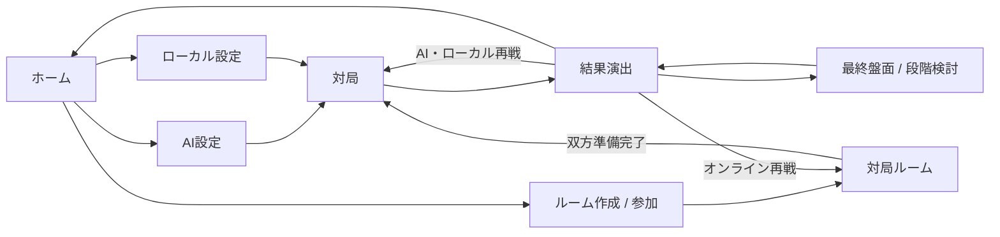
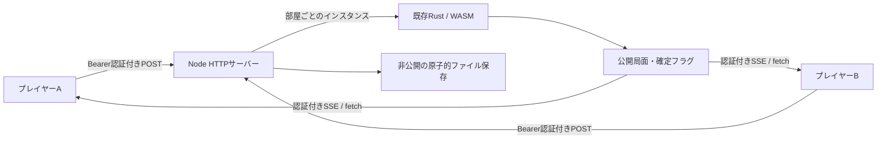

# 同時着手将棋 UI/UX・オンライン設計

調査・実装：2026-10-20。裁定は既存の RULES v0.6 / Rust コアを使用する。

## 参考と採用した判断

| 参考 | 確認した点 | 本作での判断 |
| --- | --- | --- |
| [将棋ウォーズ公式ガイド](https://shogiwars.heroz.jp/qa?locale=ja&num=29) | 盤面、自分・相手の情報、投了の配置。友達対局の部屋番号方式 | PCは相手の駒台を左上、自分の駒台を右下に配置。盤の上下を空けて、盤を画面高いっぱいに拡大。スマホは両方の駒台を盤の下に配置。設定を対局画面から退避し、6桁の番号で招待 |
| [lishogi](https://lishogi.org/) / [検討盤](https://lishogi.org/analysis) | コンピューター・友達との対局を分ける入口、盤と棋譜を組み合わせる構成 | 最初はメインメニュー。PCでは盤の横、スマートフォンでは盤の下に棋譜・段階再生 |
| [81道場クライアント](https://81dojo.com/secure_client/) | 未終局への再接続、現在局面の受信、ローカル再生・検討 | 同じ席へ自動復帰。公開状態を丸ごと再同期し、検討から現局面へワンタッチで戻す |
| [Among Us / Innersloth](https://innersloth.itch.io/among-us?click_to_load=true) | 誰に起きたイベントかを独立した演出で伝える考え方 | 衝突時だけ背景を暗くし、両者の駒・格・勝者を中央の帯で明示 |

上表から先の配色、余白、表示時間、独自の駒の造形は本作向けの設計判断。既存ゲームの画像・音声・アセットは使用していない。

駒の文字は [Yuji Boku 公式配布](https://github.com/google/fonts/tree/main/ofl/yujiboku) の15文字だけを同梱する（11.6 KB、SIL OFL 1.1、ライセンスは `web/public/fonts/OFL.txt`）。持ち駒は盤上と同じ五角形・縦横比・筆文字を使う。PCは相手の駒台が左上、自分の大きな駒台が右下。右列の上部に棋譜を置き、長い棋譜は駒台の手前で内部スクロールする。狭いタブレットとスマホでは両方の駒台と棋譜を盤の下へ移す。コンパクトなヘッダーの右端に対局メニュー、その隣に棋譜の表示切り替えと効果音を配置する。棋譜を非表示にしても駒台と対局操作は残り、表示の設定は保存する。操作の指示文は画面から取り除き、接続・確定状態はプレイヤー欄とスクリーンリーダーへ伝える。

v0.6では昇格後の任意成りをエンジンでも不適用にした。旧版の解決結果を同じルールとして扱わないよう、棋譜のルール版・正式プロファイルも更新し、v0.5の棋譜・保存済みルームは現行版で再解釈しない。

## 画面の流れ

- 暗い背景・木の盤・明るい駒で盤面に視線を集める。見出し、キャッチコピー、対局中の設定フォームを削減する。
- 盤上の駒、持ち駒ともに移動先を選ぶと送信する。成り・昇格が適用され得るときだけ、移動先の近くで「成る」「昇格 +1」の2択から選ぶ。昇格済みなら選択を出さず、強制成りだけを適用する。キャンセルや Escape で選び直せる。
- 成りは動きの変更、昇格は格 +1。文字自体を黒・赤・青で区別し、昇格から強制成りになると昇格表示も解除する。盤上・持ち駒・選択プレビュー・衝突演出は同じ筆文字を使用する。駒の格は設定で隠せる。
- 味方の占有先・障害の先・条件付きの打ちも、エンジンの指定可能手を維持する。条件付き候補は点・枠・ツールチップと読み上げ文で示す。
- ローカル2人対局は毎回、前の着手を消して交代画面を表示する。盤の向きも入力する側に合わせる。
- 対戦中の棋譜は閲覧のみとし、段階リプレイのタブと棋譜からの巻き戻しを無効にする。終局後・棋譜の検討では1ラウンドを選び「開始 → 各段階 → 成り・昇格適用後の確定局面」を確認できる。予定位置と実位置、被捕獲・打ち不成立を区別する。
- 終局は勝利・敗北・引き分けを別の文言・色で表示する。最終盤面、最初からの振り返り、再戦、ホームを選べる。
- 衝突の通常表示は約1.75秒。各駒の格とエンジンが返した勝者を表示し、同格相討ち・同格同時打ちによる持ち駒保持を区別する。連戦も独自に再判定しない。
- 効果音は未設定の端末ではオンとし、保存済みのミュート設定は維持する。ユーザー指定の `notanomori_200902020000000036.wav` を衝突に、`notanomori_201312221028410001.wav` を駒の着地に使用する。ファイルは加工せず同梱し、最初の操作で音声を準備する。着地音は各移動段階で連打せず、同時着手の解決後に1回鳴らす。開始・勝敗の合成音は維持する。動きを控える設定と OS の reduced-motion に対応し、演出はスキップできる。
- ネイティブのダイアログ、フォーカス制御、矢印での盤上移動、キーボードでの選択、aria ラベルを用意する。

## 通信・秘密入力

WebSocket の外部依存を増やさず、着手等は HTTP POST、状態通知は認証ヘッダー付き fetch の SSE を使用する。同じオリジンに画面とサーバーを置く。状態はサーバーが裁定し、クライアントは着手案だけを送る。

1. 参加時に32バイトのランダムな席用トークンを発行。部屋番号だけではプレイヤーの操作権限を取得できない。
2. `side` はトークンに結び付ける。相手側の操作、他人の駒、不正な行動、前の対局ID・ラウンドの再送を拒否する。
3. 未公開手は Rust `Match.pending` と非公開の復旧ファイル内だけに保持する。公開ビュー、棋譜、履歴、SSE、相手のレスポンスには含めない。選択肢も自分側だけを返す。
4. 片側だけの確定では公開局面・ハッシュは変わらない。両者が確定したときに同じ Rust コアで解決し、行動と結果を一緒に公開する。
5. 部屋内の更新はキューで直列化し、原子的なファイル書き換え・同期後に応答する。同一ラウンドの同一着手再送は受理するが、二重着手は発生させない。
6. 公開通知には版番号を持たせ、遅れて届いたレスポンスを捨てる。応答を失った場合は最新の全状態で照合する。

## 再接続と部屋の寿命

- 切断を検出すると相手に通知し、その間の新しい着手を停止。既存の確定手は保持する。
- SSE切断に加え、8秒ごとのクライアント heartbeat が30秒途絶えた接続を切断として扱う。そこから90秒の復帰猶予。片側が復帰しなければその側の負け、双方なら引き分け。
- 復帰用トークンはタブの sessionStorage に保存。再読込から自動復帰する。同じ席を別タブが開くと後の接続を採用し、前の接続には置き換えを通知する。
- 待機室で切断した側の準備完了は解除する。対局は双方が接続済みで準備完了になったときだけ開始する。
- 終局後、各プレイヤーは独立して検討できる。双方がルームへ戻って再度準備完了するまで次の対局を始めない。
- 明示的な退出は対局中なら負けとし、席と認証情報を解放する。待機室の空席には別の相手が参加できる。
- 対局・未公開の確定手・トークンのハッシュを保存し、再起動時に検証済み棋譜を復元して未公開手を再投入する。
- 接続のない部屋は最終更新から24時間で削除する。既定上限は256部屋。単一プロセスの構成で、複数レプリカへの分散は行わない。

## 検証

- Rust の既存回帰、独立 JS 参照との比較、ネイティブ/WASMの一致は維持。
- DOM 結合試験は実 Worker と WASM を使用し、画面遷移、即時着手、持ち駒、成り・昇格、条件付き候補、秘密交代、履歴、無効棋譜の原子的拒否、結果と再戦を操作する。
- HTTP/SSE 結合試験は独立した2クライアントで、未公開情報の不在、認証、双方準備、衝突、再送・不正入力、再戦、切断猶予、再起動時の未公開手復元、退出を確認する。
- ブラウザー試験はユーザーのプロファイルから隔離した Chrome/Chromium のPC・スマートフォン用コンテキストを使用。実際の文字色、盤比率、横はみ出し、操作、演出、再読込・ネットワーク復帰、オンライン連戦を検証し、スクリーンショットを保存する。

インターネット公開の構成と起動手順は [DEPLOYMENT.md](./DEPLOYMENT.md) を参照。公開サーバーへのデプロイは別途実施する。
